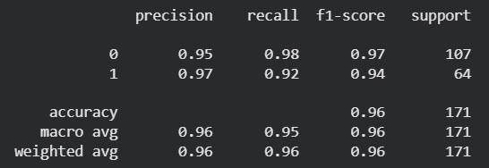

# 🎗️ Breast Cancer Prediction - Logistic Regression

A machine learning project that predicts whether a breast tumor is **Benign** (non-cancerous) or **Malignant** (cancerous) based on cellular measurements from the Wisconsin Breast Cancer Dataset.

The project includes a complete Colab notebook for data analysis and model training, and an interactive **Streamlit web app** for live predictions.

**🔗 Live Demo:** [Breast Cancer Prediction](https://your-app-link.streamlit.app)

## 📊 Dataset
The model is trained on the [Breast Cancer Wisconsin (Diagnostic) Dataset](https://www.kaggle.com/datasets/uciml/breast-cancer-wisconsin-data). The features describe characteristics of the cell nuclei present in the image, computed from a digitized image of a fine needle aspirate (FNA) of a breast mass.

## 🧠 Model Details
To keep the model interpretable and the web app user-friendly, the final model uses only **5 highly predictive features**:
1. `radius_worst`
2. `concave points_worst`
3. `area_worst`
4. `concave points_mean`
5. `perimeter_worst`

- **Algorithm:** Logistic Regression

### 📈 Evaluation Results
- **Test ROC-AUC:** `0.9969`
- **CV ROC-AUC (5-fold):** `0.9834`
- **Accuracy:** `96%`

### 🖼️ Visualizations

**Classification Report & Confusion Matrix:**
<!-- Replace 'classification_report.png' with the actual name of your image file -->


## 🖥️ The Streamlit App
The app allows users to input cell measurements via sliders and get an instant prediction with a probability score. It also includes "Load Sample Patient" buttons so you can test the model with real benign and malignant examples in one click.

## 🚀 How to Run Locally
```bash
pip install -r requirements.txt
streamlit run app.py
```
The app will open automatically in your browser at http://localhost:8501.

## 📁 Repository Structure
```bash
breast-cancer-prediction/
│
├── app.py                                               # Streamlit web application
├── breast_cancer_prediction_logistic_regression.pkl     # Trained Pipeline (Scaler + Model)
├── requirements.txt                                     # Python dependencies
├── README.md                                            # Project documentation
└── notebook/
    └── Breast_Cancer_Prediction_Logistic_Regression.ipynb # Data analysis & model training
```

## ⚠️ Disclaimer
This project is for educational and demonstration purposes only. It is not a medical device and should not be used for real-world clinical diagnosis or medical advice. Always consult a qualified healthcare professional.